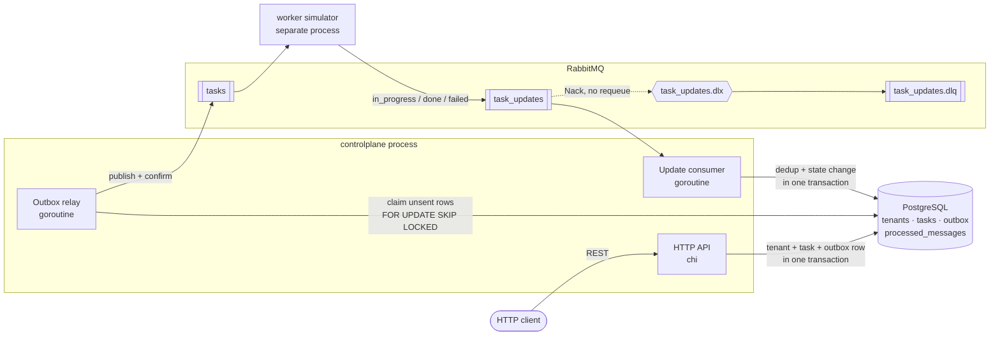
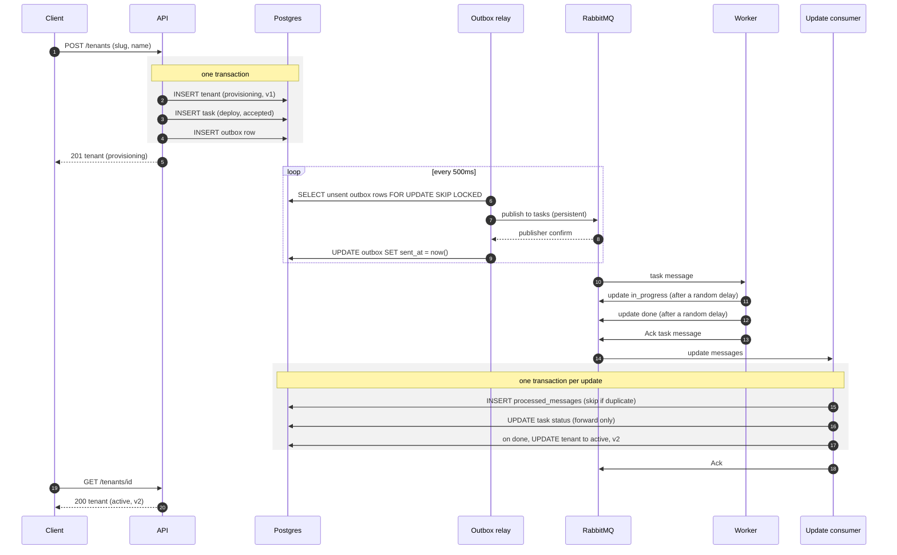

# Tenant Provisioning Control Plane

A small multi-tenant SaaS control plane in Go. Creating, updating or deleting a
tenant records a **task** and emits an event. A separate **worker simulator**
consumes tasks, fakes slow provisioning and reports progress back over
RabbitMQ. The control plane consumes those updates and advances task and
tenant state.

- **Go 1.26**, standard library first: `net/http` + chi, `log/slog`, `embed`
- **PostgreSQL 16** through pgx (plain SQL, no ORM)
- **RabbitMQ 3.13** through amqp091-go
- Everything runs in Docker. The host needs only Docker and make.

## Quick start

```bash
git clone <repo> && cd <repo>
make up      # build and boot postgres, rabbitmq, control plane and worker; waits for /healthz
make test    # run the full test suite (-race) in a golang container against the stack
```

`make up` prints the URLs:

- API: <http://localhost:8000> (health: <http://localhost:8000/healthz>)
- RabbitMQ management UI: <http://localhost:15672> (log in with `RABBITMQ_USER` / `RABBITMQ_PASSWORD` from `.env`)

The first `make` run creates `.env` from `.env.example` and fills in random
Postgres and RabbitMQ passwords. `.env` is git-ignored, so no password is ever
committed.

Create a tenant and watch it become active:

```bash
curl -s -X POST localhost:8000/tenants -H 'Content-Type: application/json' \
  -d '{"slug":"acme","name":"Acme Corp"}'
# {"id":"ce95b3cd-…","slug":"acme","name":"Acme Corp","status":"provisioning","version":1,…}

curl -s localhost:8000/tenants/<id>     # a few seconds later: "status":"active","version":2
curl -s "localhost:8000/tasks?tenant_id=<id>"   # the deploy task, "status":"done"
```

### Make targets

| Target | What it does |
|---|---|
| `make up` | `docker compose up --build -d --wait`: builds images, starts everything, waits until every healthcheck (including the control plane's `/healthz`) passes |
| `make down` | Stop and remove containers. The Postgres volume is kept. |
| `make clean` | Also remove volumes (database, Go caches) |
| `make logs` | Follow all logs |
| `make test` | `go test -race -p 1 -count=1 -v -tags integration ./...` in a `golang:1.26` container on the compose network; output is also saved to `test-results/test-<timestamp>.txt` |
| `make check` | golangci-lint (incl. gofmt/goimports check and gosec), govulncheck, then `make test` |
| `make fmt` | Rewrite files with gofmt + goimports (via `golangci-lint fmt`) |
| `make worker-fail` | Recreate the worker with `WORKER_FAIL_RATE=1` (every task fails) |
| `make worker-normal` | Recreate the worker with default settings |
| `make race` | Run `cmd/racetest` against the running API |
| `make publish ARGS="…"` | Publish a hand-written update (see [Negative scenarios](#negative-scenarios)) |

Configuration comes from environment variables, which compose reads from `.env`.
The passwords have no default. Compose refuses to start without them, and `make`
generates them, so no secret lives in the repo. Every other setting has a
default in `docker-compose.yml`. Postgres and RabbitMQ store the password on
first boot, so if you change a password or delete `.env`, run
`make clean && make up`. That also wipes the local database.

## Architecture





### Layout

```
cmd/controlplane/      API + outbox relay + update consumer, wired with errgroup
cmd/worker/            worker simulator CLI (flags, env fallback, validation)
cmd/racetest/          concurrent same-slug creates / same-version PATCHes
internal/domain/       types, timestamps, sentinel errors, message schemas, state_machine.go (pure)
internal/store/        all SQL: tenants, tasks, outbox, processed_messages, pagination
internal/api/          chi router, handlers, validation, error mapping
internal/outbox/       relay loop
internal/consumer/     inbound update consumer
internal/broker/       reconnecting AMQP connection, topology, publish with confirms, consume loop
internal/worker/       worker simulator logic (separate from main so tests can run it)
internal/retry/        exponential backoff with jitter
internal/config/       env config and logger
internal/testutil/     test database/queue isolation helpers
internal/e2e/          end-to-end tests: API + relay + consumer + worker in-process
migrations/            numbered .sql files, embedded and applied at startup
scripts/               publish_update.sh
```

Where this differs from the suggested layout, and why:
- `internal/worker` holds the simulator logic so end-to-end tests can run it in-process.
- `internal/retry` shares one backoff between broker reconnects and consumer retries.
- `internal/testutil` keeps test isolation in one place.
- The migration runner lives in `migrations/` next to its embedded files. That lets the store's own tests import the test helpers without an import cycle.

## Design decisions and trade-offs

**Transactional outbox instead of publishing after commit.** The tenant row,
the task row and an `outbox` row are written in **one** transaction. The HTTP
handler never talks to RabbitMQ. If we published right after `COMMIT`, a crash
or broker outage between the two would leave a task nobody ever hears about.
If we published before `COMMIT`, a rollback would leave a message about a task
that doesn't exist. With the outbox, "the change happened" and "an event will
be sent" are the same database fact. The cost is a short delay (the relay
polls every 500ms) and an extra table.

**At-least-once delivery plus idempotency, not exactly-once.** The relay
publishes a batch, waits for **publisher confirms**, then marks the rows sent
and commits. A crash after the confirm but before the commit means the row is
published again. Marking rows sent *before* publishing would risk losing
messages instead, which is worse. Duplicates are cheap to absorb:
- Task messages carry `MessageId = task id`.
- The worker derives its update ids from the task id.
- The consumer records every update `message_id` in `processed_messages`, in
  the same transaction as the state change.
  A redelivered update either hits the unique key (duplicate → ack, no change)
  or none of its effects were committed.

**Deterministic `message_id = "<task_id>:<status>"`.** If the worker crashes
and the task is redelivered, the re-run produces the *same* ids, so the
control plane drops what it already applied. A random id per publish would
defeat the dedup table.

**Status ranks and forward skips.** Task statuses have ranks: `accepted`=0,
`in_progress`=1, `done`/`failed`=2. An update applies only if it moves to a
strictly higher rank. The SQL is
`UPDATE … WHERE status = ANY(<statuses ranked lower>)`. This lets
`accepted → done` work if `in_progress` is lost or arrives late, and a late
`in_progress` then matches nothing and is logged as **stale**. Stale is not
an error: the message is acked and its id stays recorded. Terminal statuses
can never change.

**Optimistic locking in SQL, not check-then-act.** PATCH is one statement:
`UPDATE tenants SET …, version = version + 1 WHERE id = $1 AND version = $2
AND status = ANY($3) RETURNING …`. Only one of N concurrent PATCHes with the
same version can match. If no row matched, a follow-up read picks the error,
checking status first because a retry can't fix a wrong status:
`tenant_not_found`, then `tenant_update_not_allowed`, then
`tenant_version_conflict`. Worker-applied status changes bump `version` too,
so a client holding a pre-change version can't overwrite them.

**DB unique constraint for slugs.** Create is a plain `INSERT`. A
`23505 unique_violation` on `tenants_slug_key` becomes `tenant_already_exists`.
A "SELECT first" check would race. The tests fire 20 concurrent creates and
get exactly one 201.

**Soft delete.** `DELETE` moves a tenant to `destroying` and then
`destroyed`. Rows are never removed, so a slug stays unique across all
tenants ever created, and the task history keeps its foreign keys. A partial
unique index `tasks(tenant_id) WHERE status IN ('accepted','in_progress')`
backs up the rule "at most one open task per tenant", which the status guards
already enforce.

**DLQ instead of dropping or retrying forever.** Updates that can never
succeed are `Nack(requeue=false)`ed. RabbitMQ routes them through
`task_updates.dlx` into the durable `task_updates.dlq`, where you can inspect
or replay them. These cases are:
- invalid JSON, unknown fields, wrong `schema_version` or unknown status
- an unknown task id
- a tenant in an unexpected state
- a panic in the handler

Requeuing such a message would loop forever, and dropping it would hide the
bug. Transient failures, such as the database being down, are retried
instead: `Nack(requeue=true)` after exponential backoff with jitter, capped at
30s.

**Plain SQL with pgx instead of an ORM.** Every important guarantee here
(conditional updates, `SKIP LOCKED`, `ON CONFLICT DO NOTHING`, partial unique
indexes, keyset pagination) is a SQL feature. Writing the SQL directly keeps
those guarantees visible and reviewable in one package (`internal/store`).

**chi instead of the stdlib mux.** chi is a thin, `net/http`-compatible
router. It gives route groups, URL params, and JSON 404/405 handlers without
extra wrapping. The handlers stay ordinary `http.HandlerFunc`s.

**Hand-rolled AMQP reconnect.** amqp091-go doesn't reconnect by itself.
`broker.Conn.Run` watches `NotifyClose`, redials with backoff and redeclares
the topology on every connect. Publishers and consumers ask it for a fresh
channel whenever theirs closes. Topology declaration is idempotent, so both
processes run it on every connect. A test force-closes the connection
through the management API and checks that publishing and consuming resume.

**One process for API, relay and consumer.** It's simpler to run and reason
about. All three share one pool, one broker connection and one context: a
SIGINT/SIGTERM or a failing component cancels it, the HTTP server drains, and
the relay and consumer stop. In-flight updates finish under their own short
timeout. They scale independently later if needed (see limitations). The
relay already uses `SKIP LOCKED`, so several instances wouldn't send the same
row at once.

**Go 1.26 rather than 1.23.** The original brief pinned Go 1.23. That
release is end-of-life, and `govulncheck` reports dozens of reachable
standard-library vulnerabilities in it (crypto/tls, crypto/x509, net/http, …)
that will never be fixed on that line. Some are only fixed in Go 1.26.x, so
this project uses Go 1.26 with current chi, pgx, amqp091-go and x/text, and
`make check` reports no vulnerabilities. The only code change it needed was
fixing the healthcheck probe to loopback, which the newer gosec asked for.

**Pagination.** The cursor is an opaque base64 encoding of
`(created_at, id)` at full timestamp precision. Lists are ordered by that
pair ascending, and the next page uses `(created_at, id) > (cursor)`. The
default limit is 20 and the maximum is 100.

## State machines

```
Task:    accepted ──► in_progress ──► done
             │              └───────► failed
             └──(forward skip)──► done | failed

Tenant:  POST ──► provisioning ──deploy done──► active ──PATCH──► updating ──update done──► active
                       └──deploy failed──► failed          └──update failed──► failed
         DELETE (from active or failed) ──► destroying ──destroy done──► destroyed
                                                  └──destroy failed──► failed
```

The rules live in `internal/domain/state_machine.go` as pure functions,
shared by the store (SQL guards) and the consumer.

## API reference

All responses are JSON. Timestamps are ISO 8601 UTC with milliseconds, e.g.
`2026-11-03T10:15:02.123Z`. Errors always look like this:

```json
{"error": {"code": "tenant_not_found", "message": "tenant not found", "details": {}}}
```

| Code | HTTP | When |
|---|---|---|
| `validation_error` | 422 | malformed JSON, unknown fields, bad slug, empty name, missing/invalid version, bad query params. `details` names the fields |
| `tenant_not_found` | 404 | unknown tenant id. **Invalid UUIDs in the path also get 404**, because they can't match any row. |
| `task_not_found` | 404 | unknown or invalid task id |
| `tenant_already_exists` | 409 | slug taken, including by a destroyed tenant |
| `tenant_update_not_allowed` | 409 | PATCH when not `active`; DELETE when not `active`/`failed` |
| `tenant_version_conflict` | 409 | PATCH with a stale `version` |
| `route_not_found` / `method_not_allowed` | 404 / 405 | unknown route or method |
| `internal_error` | 500 | unexpected failure. The cause is logged, never returned. |
| `service_unavailable` | 503 | `/healthz` when a dependency is down |

### `POST /tenants`

```bash
curl -i -X POST localhost:8000/tenants -H 'Content-Type: application/json' \
  -d '{"slug":"acme","name":"Acme Corp"}'
# 201 Created, Location: /tenants/<id>
# {"id":"…","slug":"acme","name":"Acme Corp","status":"provisioning","version":1,"created_at":"…","updated_at":"…"}
```

- `slug` must be 3-28 characters and match `^[a-z][-a-z0-9]{1,26}[a-z0-9]$`.
- `name` is trimmed and must not be empty.

Errors:

```bash
# 409 tenant_already_exists
curl -s -X POST localhost:8000/tenants -d '{"slug":"acme","name":"Again"}'
# 422 validation_error, details.slug
curl -s -X POST localhost:8000/tenants -d '{"slug":"Bad_Slug","name":"x"}'
# 422 validation_error, details.name
curl -s -X POST localhost:8000/tenants -d '{"slug":"acme2","name":"   "}'
# 422 validation_error, details.body (unknown field)
curl -s -X POST localhost:8000/tenants -d '{"slug":"acme2","name":"x","plan":"gold"}'
# 422 validation_error, details.body (malformed JSON)
curl -s -X POST localhost:8000/tenants -d '{"slug":'
```

### `GET /tenants`

Query parameters: `status`, `limit` (1-100, default 20) and `cursor`.

```bash
curl -s "localhost:8000/tenants?status=active&limit=2"
# {"items":[…],"next_cursor":"eyJj…"}      next_cursor is null on the last page
curl -s "localhost:8000/tenants?limit=2&cursor=eyJj…"
# 422 validation_error: status=bogus, limit=0, limit=101, cursor=garbage
curl -s "localhost:8000/tenants?status=bogus"
```

### `GET /tenants/{id}`

```bash
curl -s localhost:8000/tenants/<id>                  # 200 tenant
curl -s localhost:8000/tenants/00000000-0000-0000-0000-000000000000   # 404 tenant_not_found
curl -s localhost:8000/tenants/not-a-uuid            # 404 tenant_not_found
```

### `PATCH /tenants/{id}`

Only allowed while the tenant is `active`. It moves the tenant to `updating`
and creates an `update` task.

```bash
curl -s -X PATCH localhost:8000/tenants/<id> -d '{"name":"Acme Inc","version":2}'
# 202 {"…","name":"Acme Inc","status":"updating","version":3}
```

Errors:

```bash
# 409 tenant_version_conflict (version is stale)
curl -s -X PATCH localhost:8000/tenants/<id> -d '{"name":"x","version":1}'
# 409 tenant_update_not_allowed (tenant is provisioning/updating/destroying/destroyed/failed)
curl -s -X PATCH localhost:8000/tenants/<id> -d '{"name":"x","version":3}'
# 422 validation_error (missing version / missing or blank name / unknown field)
curl -s -X PATCH localhost:8000/tenants/<id> -d '{"name":"x"}'
# 404 tenant_not_found
curl -s -X PATCH localhost:8000/tenants/00000000-0000-0000-0000-000000000000 -d '{"name":"x","version":1}'
```

### `DELETE /tenants/{id}`

Only allowed from `active` or `failed`. It moves the tenant to `destroying`,
then `destroyed` once the worker reports done. The row is never removed.

```bash
curl -s -X DELETE localhost:8000/tenants/<id>   # 202 {"…","status":"destroying"}
curl -s -X DELETE localhost:8000/tenants/<id>   # 409 tenant_update_not_allowed (already destroying)
curl -s -X DELETE localhost:8000/tenants/00000000-0000-0000-0000-000000000000   # 404 tenant_not_found
```

### `GET /tasks`

Query parameters: `tenant_id`, `status` (accepted|in_progress|done|failed),
`type` (deploy|update|destroy), `limit` and `cursor`.

```bash
curl -s "localhost:8000/tasks?tenant_id=<id>"
# {"items":[{"id":"…","type":"deploy","tenant_id":"…","status":"done","error":null,"created_at":"…","updated_at":"…"}],"next_cursor":null}
curl -s "localhost:8000/tasks?type=destroy&status=failed"
curl -s "localhost:8000/tasks?tenant_id=nope"    # 422 validation_error
```

### `GET /tasks/{id}`

```bash
curl -s localhost:8000/tasks/<task_id>           # 200 task
curl -s localhost:8000/tasks/not-a-uuid          # 404 task_not_found
```

### `GET /healthz`

```bash
curl -s localhost:8000/healthz
# 200 {"status":"ok","checks":{"database":"ok","broker":"ok"}}
# 503 {"error":{"code":"service_unavailable",…,"details":{"broker":"broker not connected","database":"ok"}}}
```

## Messages

Task message, sent to the `tasks` queue (persistent, `MessageId` = task id):

```json
{"event_id":"<task id>","task_id":"<task id>","type":"deploy","tenant_id":"…",
 "status":"accepted","created_at":"2026-11-03T10:15:02.123Z","schema_version":1}
```

Update message, sent by the worker to the `task_updates` queue:

```json
{"message_id":"<task id>:done","task_id":"…","status":"done","error":null,
 "occurred_at":"2026-11-03T10:15:04.456Z","schema_version":1}
```

## Worker simulator

Every flag can also be set with an environment variable. A flag on the
command line wins. Invalid values make the worker exit with code 2 and a
clear message.

| Flag | Env | Default |
|---|---|---|
| `-fail-rate` (0-1) | `WORKER_FAIL_RATE` | 0 |
| `-min-delay-ms` | `WORKER_MIN_DELAY_MS` | 500 |
| `-max-delay-ms` | `WORKER_MAX_DELAY_MS` | 2000 |
| `-duplicate-rate` (0-1) | `WORKER_DUPLICATE_RATE` | 0 |
| `-skip-in-progress` | `WORKER_SKIP_IN_PROGRESS` | false |
| `-concurrency` | `WORKER_CONCURRENCY` | 4 |

For each task, the worker:
1. sleeps,
2. publishes `in_progress`,
3. sleeps,
4. publishes `done`, or `failed` with an error string,
5. waits for publisher confirms, then acks the task.

If it's interrupted, the task is requeued, and the re-run produces the same
message ids.

## Negative scenarios

Run these against a stack started with `make up`.

**Worker failures**, ending in a failed tenant that can then be destroyed:

```bash
make worker-fail
curl -s -X POST localhost:8000/tenants -d '{"slug":"doomed","name":"Doomed"}'
curl -s localhost:8000/tenants/<id>                    # "status":"failed"
curl -s "localhost:8000/tasks?tenant_id=<id>"          # "error":"simulated deploy failure"
make worker-normal
curl -s -X DELETE localhost:8000/tenants/<id>          # destroying
curl -s localhost:8000/tenants/<id>                    # shortly: destroyed
```

**Duplicate updates.** The same `done` message is sent twice. The logs show
`duplicate update ignored`, and the tenant version doesn't change:

```bash
make publish ARGS="duplicate <task_id>"
make logs   # or: docker compose logs controlplane | grep duplicate
```

You can also make the worker itself send every update twice:

```bash
WORKER_DUPLICATE_RATE=1 docker compose up -d --no-deps --force-recreate worker
```

**Out-of-order updates.** A late `in_progress` arrives after `done`. It uses
a fresh message_id, so it gets past dedup and reaches the rank check. The
logs show `stale update ignored`:

```bash
make publish ARGS="stale <task_id>"
```

To exercise the forward skip (`accepted → done`), run the worker without
`in_progress` updates:

```bash
WORKER_SKIP_IN_PROGRESS=true docker compose up -d --no-deps --force-recreate worker
```

**Poison messages.** These are dead-lettered, and the consumer keeps going:

```bash
make publish ARGS=poison           # invalid JSON
make publish ARGS=unknown-task     # well-formed, but the task doesn't exist
docker compose exec rabbitmq rabbitmqctl list_queues name messages
# task_updates.dlq   2
```

You can also inspect `task_updates.dlq` in the management UI
(<http://localhost:15672>, Queues tab, then Get messages).

**Concurrency race**:

```bash
make race
# Race 1: 20 concurrent POST /tenants with slug "race-…"
#   201                                      x1
#   409 tenant_already_exists                x19
# Race 2: 20 concurrent PATCH /tenants/… with version 2
#   202                                      x1
#   409 tenant_update_not_allowed            x19
# OK: exactly one winner in each race.
```

The PATCH losers report either `tenant_update_not_allowed` or
`tenant_version_conflict`, depending on whether they see the winner's new
status or its new version first. Either way they change nothing.

## Tests

`make test` runs `go test -race` over every package against the real Postgres
and RabbitMQ from compose. The verbose output (every test by name, with
`PASS`/`FAIL`) is printed and also saved to `test-results/test-<timestamp>.txt`,
one file per run. That folder is git-ignored.

- **Unit tests**:
  - table-driven tests for every allowed and forbidden task and tenant transition
  - slug, name and timestamp validation, and strict message decoding
  - worker flag parsing and validation
  - backoff
  - the panic recoverer and error mapping
- **Store**:
  - migrations are idempotent
  - a rolled-back transaction leaves no outbox row; a committed one leaves exactly one
  - optimistic locking errors
  - pagination
  - the relay stops at the first publish error
- **API**:
  - every endpoint and every error code, plus validation and pagination, tested with `httptest` against the real router and database
  - 20 concurrent same-slug creates give exactly one 201
  - 20 concurrent same-version PATCHes give exactly one 202
  - a PATCH racing a worker status change loses
- **Broker and outbox**:
  - persistent messages with confirms
  - idempotent topology
  - reconnect after a server-side connection close
  - the relay publishes and marks rows sent
  - a resend after a simulated crash before marking sent
- **Consumer**:
  - duplicate updates change nothing
  - a late `in_progress` after `done` is ignored
  - updates for terminal tasks are ignored
  - the `accepted → done` skip works
  - poison messages and handler panics land in the DLQ while the next message still applies
  - transient errors are retried
  - tenant version bumps on worker-applied changes
- **End to end** (API, relay, consumer and worker in-process):
  - create → active
  - fail-rate=1 → failed, then DELETE → destroying → destroyed
  - duplicate-rate=1 with skip-in-progress converges
  - a relay resend is harmless

Isolation: integration tests use a separate `controlplane_test` database,
truncated per test, and per-test queue names (`test-<random>.tasks`, …). They
never touch the running stack's data or compete with its consumers, and they
can run repeatedly. Packages share the test database, so they run with `-p 1`.
Integration tests carry the `integration` build tag, so
`go test ./...` without the stack runs only the unit tests.

## Known limitations / future work

- **Outbox cleanup:** sent rows (and `processed_messages`) are kept forever.
  They need a periodic job that deletes rows older than N days.
- **Stuck tasks:** if the worker never reports back, the task stays open and
  the tenant stays in `provisioning`/`updating`/`destroying`. This needs a
  timeout sweeper that fails tasks after a deadline.
- **Metrics/tracing:** logs are structured JSON, but there are no Prometheus
  metrics (relay lag, DLQ depth, consumer outcomes) and no trace propagation
  through messages.
- **DLQ replay:** messages can be inspected in the UI, but there's no tool to
  fix and replay them.
- **Multi-relay scaling:** `SKIP LOCKED` keeps multiple relays from sending
  the same row concurrently, but message order across relays isn't
  guaranteed. Ordering doesn't matter for correctness here, because each
  tenant has one open task at a time and updates are rank-guarded. Publishing
  also happens while row locks are held, so a slow broker slows the relay.
  - At higher volume, use LISTEN/NOTIFY instead of polling.
  - Or move to logical-replication CDC.
- **Pagination under concurrent inserts:** keyset pagination on `created_at`
  can miss a row whose transaction committed after a later-timestamped one
  was already paged past. This is acceptable for an admin listing.
- **Auth, rate limiting, multi-region:** out of scope.
