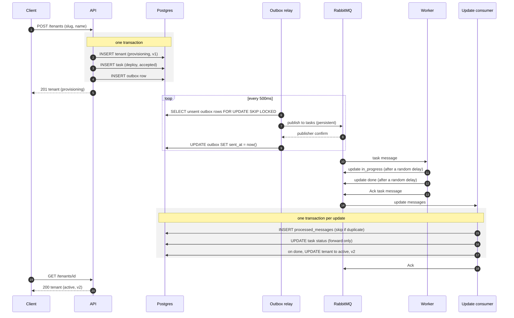

# Tenant Provisioning Control Plane

A small multi-tenant control plane in Go. Creating, updating or deleting a
tenant records a **task** and emits an event. A separate **worker** consumes
tasks, simulates slow provisioning and reports progress back over RabbitMQ; the
control plane applies those updates to task and tenant state.

Go 1.26 (`net/http` + chi, `log/slog`), PostgreSQL 16 via pgx (plain SQL),
RabbitMQ 3.13 via amqp091-go. Everything runs in Docker; the host needs only
Docker and make.

## Setup

```bash
git clone https://github.com/pj-1009/controlplane.git && cd controlplane
make up      # build and start postgres, rabbitmq, control plane and worker; waits for /healthz
make test    # every test, with -race, in a golang container against real postgres + rabbitmq
```

- API: <http://localhost:8000> (health: `/healthz`)
- RabbitMQ UI: <http://localhost:15672>, login from `.env`

To run on a local Kubernetes cluster instead, install
[kind](https://kind.sigs.k8s.io/) and run `make k8s-up`: the API is then on
<http://localhost:8080>. See [docs/kubernetes.md](docs/kubernetes.md).

The first `make` creates a git-ignored `.env` from `.env.example` with random
Postgres and RabbitMQ passwords, so no secret is in the repo. Postgres keeps the password it first
started with: if you delete `.env` or switch checkouts, run
`make clean && make up` (this wipes the local database).

```bash
curl -s -X POST localhost:8000/tenants -H 'Content-Type: application/json' -d '{"slug":"acme","name":"Acme Corp"}'
# 201 {"id":"ce95b3cd-…","slug":"acme","status":"provisioning","version":1,…}
curl -s localhost:8000/tenants/<id>              # a few seconds later: "status":"active","version":2
curl -s "localhost:8000/tasks?tenant_id=<id>"    # the deploy task, "status":"done"
```

| Target | What it does |
|---|---|
| `make up` / `down` / `logs` | `docker compose up --build -d --wait` / stop (data kept) / follow logs |
| `make clean` | Stop and delete volumes (database, Go caches) |
| `make test` | `go test -race -p 1 -count=1 -v -tags integration ./...`; output also saved to `test-results/` |
| `make lint` / `fmt` / `vuln` | golangci-lint (formatting, vet, gosec, …) / fix formatting / govulncheck; each runs on demand |
| `make check` | `lint`, `vuln`, then `test`: the CI gate |
| `make worker-fail` / `worker-normal` | Restart the worker failing every task / with defaults |
| `make race` | 20 concurrent same-slug creates and same-version PATCHes against the running API |
| `make publish ARGS="…"` | Publish a hand-written update (see [Negative scenarios](#negative-scenarios)) |
| `make k8s-up` / `k8s-status` / `k8s-logs` | Deploy to a local kind cluster and wait until ready / list pods / follow logs from every pod |
| `make k8s-down` / `k8s-clean` | Remove the app from the cluster (data kept) / delete the cluster |

Guides with full outputs are in [`docs/`](docs/README.md): [setup](docs/setup.md),
[create](docs/create-tenant.md), [create errors](docs/create-tenant-errors.md),
[update](docs/update-tenant.md), [delete](docs/delete-tenant.md),
[tests](docs/testing.md), [CI/CD](docs/cicd.md), [error messages](docs/errors.md),
[the API contract](docs/spec-driven.md), [database providers](docs/database-providers.md)
and [Kubernetes](docs/kubernetes.md).

## Architecture




```
cmd/controlplane/          API + outbox relay + update consumer, wired with errgroup
cmd/worker/                worker CLI: flags, env fallback, validation
cmd/racetest/              the `make race` load test
internal/domain/           types, errors, message schemas, state machine (pure functions)
internal/store/            the Store interface every database provider implements, plus paging types
internal/store/postgres/   the Postgres provider: all SQL, and its migrations/ (numbered .sql, applied at startup)
internal/store/memory/     an in-memory provider, proving the interface is provider-neutral
internal/store/storetest/  conformance suite every provider must pass
internal/store/drivers/    picks a provider by name (DB_DRIVER)
internal/api/              router, handlers, validation, error mapping
internal/outbox/           relay loop
internal/consumer/         update consumer
internal/broker/           reconnecting AMQP connection, topology, publish with confirms, consume loop
internal/worker/           worker logic, separate from main so end-to-end tests can run it
internal/retry/            backoff with jitter, shared by reconnects and consumer retries
internal/config/           env config and logger
internal/testutil/         test stores (any provider, via TEST_DB_DRIVER) and queue isolation
internal/e2e/              end-to-end tests, everything in one process
deploy/k8s/                Kubernetes manifests (Kustomize) and the local kind cluster config
spec/                      openapi.yaml, the API contract, and the checker the tests use
scripts/                   publish_update.sh
```

## Design decisions

**Outbox, not publish-after-commit.** The tenant, its task and an `outbox` row
are written in one transaction, and the HTTP handler never talks to RabbitMQ.
Publishing after `COMMIT` loses the task if we crash in between; publishing
before it announces tasks that may roll back. The cost is up to 500ms of delay
(the relay polls) and one extra table.

**At-least-once delivery plus idempotency.** The relay publishes, waits for
publisher confirms, then marks rows sent. A crash between the two resends the
row, which is safe; marking first could lose it. The consumer records each
update's `message_id` in `processed_messages` in the same transaction as the
state change, so a redelivery is either a recorded duplicate (ack, no change)
or nothing of it was committed.

**Deterministic `message_id = "<task_id>:<status>"`.** A redelivered task
produces the same update ids on re-run, so dedup catches them. Random ids would
defeat the dedup table.

**Status ranks with forward skips.** `accepted`=0, `in_progress`=1,
`done`/`failed`=2. An update applies only if it raises the rank
(`UPDATE … WHERE status = ANY(<lower ranks>)`). So `accepted → done` works if
`in_progress` is lost, a late `in_progress` is acked as **stale**, and terminal
statuses never change.

**Optimistic locking in one SQL statement.** PATCH runs
`UPDATE tenants SET status = 'updating', version = version + 1 WHERE id = $1 AND version = $3 AND status = ANY($4)`,
so only one of N concurrent PATCHes with the same version matches. When none
match, a re-read picks the error: `tenant_not_found`, then
`tenant_update_not_allowed`, then `tenant_version_conflict`. Worker changes bump
the version too. The new name rides on the update task (`requested_name`) and
is applied only when that task is `done`, so a failed update keeps the old name.

**Database unique constraint for slugs.** Create is a plain `INSERT`; a
`23505` on `tenants_slug_key` becomes `tenant_already_exists`. Checking with a
`SELECT` first would race.

**Soft delete.** DELETE moves a tenant to `destroying`, then `destroyed`; rows
are never removed, so slugs stay unique forever and task history keeps its
foreign keys. A partial unique index allows at most one open task per tenant,
as a safety net under the status rules.

**DLQ, not drop or retry forever.** Updates that can never succeed (bad JSON,
unknown fields or schema version, unknown task, impossible transition, a
handler panic) are `Nack(requeue=false)`ed into `task_updates.dlq` through
`task_updates.dlx`. Transient errors such as the database being down are
`Nack(requeue=true)`ed after exponential backoff with jitter, capped at 30s.

**Plain SQL with pgx, no ORM.** The guarantees here (conditional updates,
`SKIP LOCKED`, `ON CONFLICT DO NOTHING`, partial indexes, keyset pagination)
are SQL features, and keeping them as SQL in `internal/store/postgres` keeps them visible.

**The database is swappable.** Everything outside `internal/store/<provider>`
depends only on the `store.Store` interface, and `DB_DRIVER` picks the
provider at startup. A new provider passes the shared conformance suite and
then the full test suite (`make test-memory` shows this for the in-memory
one). See [docs/database-providers.md](docs/database-providers.md).

**chi, not the stdlib mux.** A thin `net/http`-compatible router with route
groups, URL params and JSON 404/405 handlers; handlers stay plain
`http.HandlerFunc`s.

**Hand-rolled AMQP reconnect.** amqp091-go doesn't reconnect. `broker.Conn.Run`
watches `NotifyClose`, redials with backoff and redeclares the (idempotent)
topology; publishers and consumers take a fresh channel when theirs closes. A
test cuts the connection through the management API and checks both resume.

**One process for API, relay and consumer.** Simpler to run: one pool, one
broker connection, one context. SIGINT/SIGTERM or any failing part cancels it,
HTTP drains, relay and consumer stop. They can be split later; the relay's
`SKIP LOCKED` already allows several instances.

**Also:** Go 1.26 instead of the brief's 1.23, because 1.23 is end-of-life and
govulncheck reports standard-library vulnerabilities fixed only in newer
releases. Pagination is keyset-based: an opaque base64 cursor of
`(created_at, id)`, next page `WHERE (created_at, id) > cursor`, default limit
20, max 100.

## State machines

```
Task:    accepted ──► in_progress ──► done
             │              └───────► failed
             └──(forward skip)──► done | failed

Tenant:  POST ──► provisioning ──deploy done──► active ──PATCH──► updating ──update done──► active
                       └──deploy failed──► failed          └──update failed──► failed
         DELETE (from active or failed) ──► destroying ──destroy done──► destroyed
                                                  └──destroy failed──► failed
```

The rules are pure functions in `internal/domain/state_machine.go`, used by the
store's SQL guards and by the consumer.

## API reference

The full contract is [`spec/openapi.yaml`](spec/openapi.yaml); the tests check
every response against it ([how](docs/spec-driven.md)). JSON everywhere; timestamps are UTC with milliseconds (`2026-11-03T10:15:02.123Z`).
Every error has the same shape:

```json
{"error": {"code": "tenant_not_found", "message": "tenant not found", "details": {}}}
```

| Code | HTTP | When |
|---|---|---|
| `validation_error` | 422 | Bad JSON, unknown field, bad slug, blank name, missing or invalid version, bad query parameter; `details` names the field |
| `tenant_not_found` / `task_not_found` | 404 | Unknown id; **an id that isn't a UUID also gets 404** |
| `tenant_already_exists` | 409 | Slug taken, including by a destroyed tenant |
| `tenant_update_not_allowed` | 409 | PATCH when not `active`; DELETE when not `active` or `failed` |
| `tenant_version_conflict` | 409 | PATCH with a stale `version` |
| `route_not_found` / `method_not_allowed` | 404 / 405 | Unknown route or method |
| `internal_error` | 500 | Unexpected failure; the cause is logged, never returned |
| `service_unavailable` | 503 | `/healthz` when the database or broker is down |

Every message text is listed in [docs/errors.md](docs/errors.md).

**`POST /tenants`**: `slug` matches `^[a-z][-a-z0-9]{1,26}[a-z0-9]$` (3–28
characters); `name` is trimmed and must not be blank.

```bash
curl -i -X POST localhost:8000/tenants -d '{"slug":"acme","name":"Acme Corp"}'   # 201, Location: /tenants/<id>
curl -s -X POST localhost:8000/tenants -d '{"slug":"acme","name":"Again"}'       # 409 tenant_already_exists
curl -s -X POST localhost:8000/tenants -d '{"slug":"Bad_Slug","name":"x"}'       # 422 details.slug
curl -s -X POST localhost:8000/tenants -d '{"slug":"acme2","name":"   "}'        # 422 details.name
curl -s -X POST localhost:8000/tenants -d '{"slug":"acme2","name":"x","plan":"gold"}'   # 422 details.body (unknown field)
curl -s -X POST localhost:8000/tenants -d '{"slug":'                             # 422 details.body (bad JSON)
```

**`GET /tenants`**: `status`, `limit` (1–100, default 20), `cursor`.

```bash
curl -s "localhost:8000/tenants?status=active&limit=2"   # {"items":[…],"next_cursor":"eyJj…"}, null on the last page
curl -s "localhost:8000/tenants?limit=2&cursor=eyJj…"    # next page
curl -s "localhost:8000/tenants?status=bogus"            # 422 (also limit=0, limit=101, cursor=garbage)
```

**`GET /tenants/{id}`**

```bash
curl -s localhost:8000/tenants/<id>                                     # 200
curl -s localhost:8000/tenants/00000000-0000-0000-0000-000000000000     # 404 tenant_not_found
curl -s localhost:8000/tenants/not-a-uuid                               # 404 tenant_not_found
```

**`PATCH /tenants/{id}`**: only when `active`. The tenant goes to `updating`
and keeps its current name until the update task is `done`.

```bash
curl -s -X PATCH localhost:8000/tenants/<id> -d '{"name":"Acme Inc","version":2}'   # 202, "status":"updating","version":3
curl -s -X PATCH localhost:8000/tenants/<id> -d '{"name":"x","version":1}'          # 409 tenant_version_conflict
curl -s -X PATCH localhost:8000/tenants/<id> -d '{"name":"x","version":3}'          # 409 tenant_update_not_allowed (not active)
curl -s -X PATCH localhost:8000/tenants/<id> -d '{"name":"x"}'                      # 422 (also blank name, unknown field)
curl -s -X PATCH localhost:8000/tenants/00000000-0000-0000-0000-000000000000 -d '{"name":"x","version":1}'   # 404
```

**`DELETE /tenants/{id}`**: only from `active` or `failed`; goes to
`destroying`, then `destroyed`. The row is kept.

```bash
curl -s -X DELETE localhost:8000/tenants/<id>    # 202, "status":"destroying"
curl -s -X DELETE localhost:8000/tenants/<id>    # 409 tenant_update_not_allowed (already destroying)
curl -s -X DELETE localhost:8000/tenants/00000000-0000-0000-0000-000000000000   # 404 tenant_not_found
```

**`GET /tasks`**: `tenant_id`, `status` (accepted, in_progress, done, failed),
`type` (deploy, update, destroy), `limit`, `cursor`. `requested_name` is set on
update tasks only.

```bash
curl -s "localhost:8000/tasks?tenant_id=<id>"
# {"items":[{"id":"…","type":"deploy","tenant_id":"…","status":"done","error":null,"requested_name":null,"created_at":"…","updated_at":"…"}],"next_cursor":null}
curl -s "localhost:8000/tasks?type=destroy&status=failed"
curl -s "localhost:8000/tasks?tenant_id=nope"    # 422 validation_error
```

**`GET /tasks/{id}`**, **`GET /healthz`** and **`GET /livez`**

```bash
curl -s localhost:8000/tasks/<task_id>     # 200
curl -s localhost:8000/tasks/not-a-uuid    # 404 task_not_found
curl -s localhost:8000/healthz             # 200 {"status":"ok","checks":{"database":"ok","broker":"ok"}}
# 503 {"error":{"code":"service_unavailable",…,"details":{"broker":"broker not connected","database":"ok"}}}
curl -s localhost:8000/livez               # 200 {"status":"ok"}, even when the database is down (liveness probe)
```

**Messages.** Task messages go to `tasks` (persistent, `MessageId` = task id);
updates come back on `task_updates`:

```json
{"event_id":"<task id>","task_id":"<task id>","type":"deploy","tenant_id":"…","status":"accepted","created_at":"2026-11-03T10:15:02.123Z","schema_version":1}
{"message_id":"<task id>:done","task_id":"…","status":"done","error":null,"occurred_at":"2026-11-03T10:15:04.456Z","schema_version":1}
```

## Worker

For each task the worker sleeps, publishes `in_progress`, sleeps, publishes
`done` (or `failed` with an error), waits for publisher confirms, then acks.
If interrupted, the task is requeued and the re-run sends the same message ids.

| Flag | Env | Default |
|---|---|---|
| `-fail-rate` (0–1) | `WORKER_FAIL_RATE` | 0 |
| `-min-delay-ms` / `-max-delay-ms` | `WORKER_MIN_DELAY_MS` / `WORKER_MAX_DELAY_MS` | 500 / 2000 |
| `-duplicate-rate` (0–1) | `WORKER_DUPLICATE_RATE` | 0 |
| `-skip-in-progress` | `WORKER_SKIP_IN_PROGRESS` | false |
| `-concurrency` | `WORKER_CONCURRENCY` | 4 |

A flag beats its env var; invalid values exit with code 2. Each task runs in
its own goroutine, and `-concurrency` is the RabbitMQ prefetch, so a worker
never holds more than that many unacked tasks. To scale:
`WORKER_CONCURRENCY=16 make worker-normal`, or `docker compose up -d --scale worker=3`.

## Negative scenarios

Against a running `make up`:

```bash
# Worker failure: the tenant ends failed, then can be destroyed
make worker-fail
curl -s -X POST localhost:8000/tenants -d '{"slug":"doomed","name":"Doomed"}'
curl -s localhost:8000/tenants/<id>                 # "status":"failed"
curl -s "localhost:8000/tasks?tenant_id=<id>"       # "error":"simulated deploy failure"
make worker-normal
curl -s -X DELETE localhost:8000/tenants/<id>       # destroying, shortly destroyed

# Duplicates: the same "done" twice; logs show "duplicate update ignored", version unchanged
make publish ARGS="duplicate <task_id>"
WORKER_DUPLICATE_RATE=1 docker compose up -d --no-deps --force-recreate worker   # worker doubles every update

# Out of order: a late in_progress with a fresh id gets past dedup; logs show "stale update ignored"
make publish ARGS="stale <task_id>"
WORKER_SKIP_IN_PROGRESS=true docker compose up -d --no-deps --force-recreate worker   # forward skip accepted -> done

# Poison: dead-lettered while the consumer keeps going
make publish ARGS=poison            # invalid JSON
make publish ARGS=unknown-task      # valid shape, unknown task
docker compose exec rabbitmq rabbitmqctl list_queues name messages   # task_updates.dlq 2

# Races: exactly one winner each
make race
# Race 1: 20 concurrent POST /tenants  -> 201 x1, 409 tenant_already_exists x19
# Race 2: 20 concurrent PATCH, same version -> 202 x1, 409 x19
```

PATCH losers in the race see `tenant_update_not_allowed` or
`tenant_version_conflict`, depending on whether they see the winner's new
status or new version first; either way they change nothing.

## Tests

`make test` runs unit, integration and end-to-end tests with `-race` against
real Postgres and RabbitMQ. Integration tests use a separate `controlplane_test`
database and random queue names, so they never touch the running stack.
Coverage by package, running a single test, and reading results are in
[docs/testing.md](docs/testing.md).

## Known limitations

- **Outbox cleanup:** sent outbox rows and `processed_messages` are kept forever; they need a periodic delete.
- **Stuck tasks:** if the worker never answers, the tenant stays `provisioning`, `updating` or `destroying`; this needs a timeout sweeper.
- **Metrics and tracing:** structured logs only; no Prometheus metrics (relay lag, DLQ depth) or trace propagation.
- **DLQ replay:** messages can be inspected in the UI, but there's no tool to fix and resend them.
- **Multi-relay scaling:** `SKIP LOCKED` prevents double sends, but order across relays isn't guaranteed (harmless here: one open task per tenant, rank-guarded updates), and publishing while holding row locks means a slow broker slows the relay. At volume, use LISTEN/NOTIFY or change data capture instead of polling.
- **Pagination under concurrent inserts:** keyset pagination on `created_at` can skip a row that commits late; acceptable for an admin listing.
- **Not in scope:** authentication, rate limiting, multi-region.
